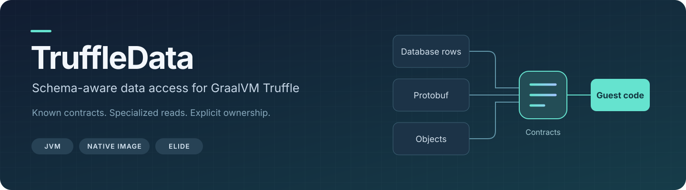
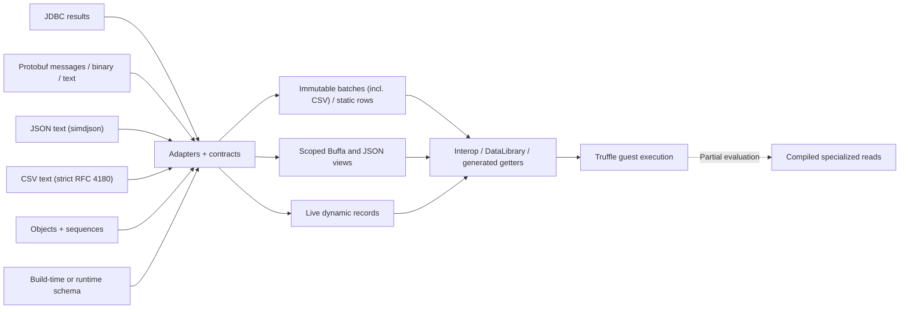
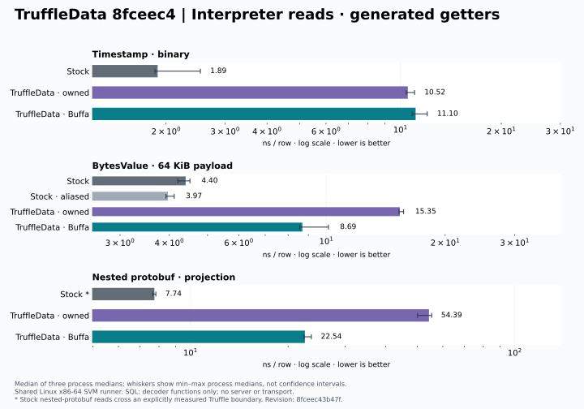
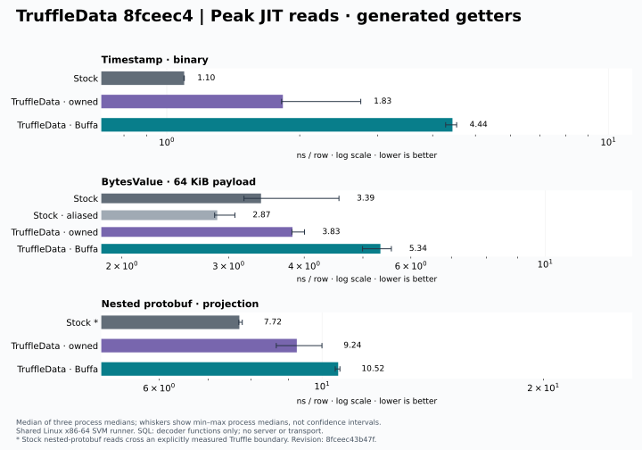
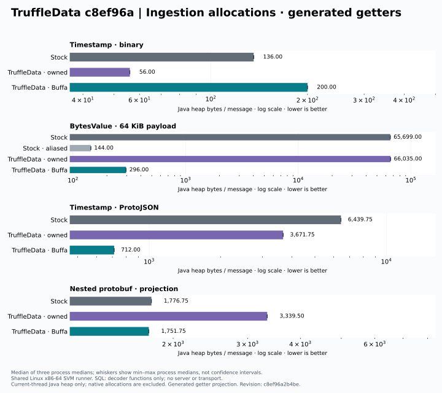
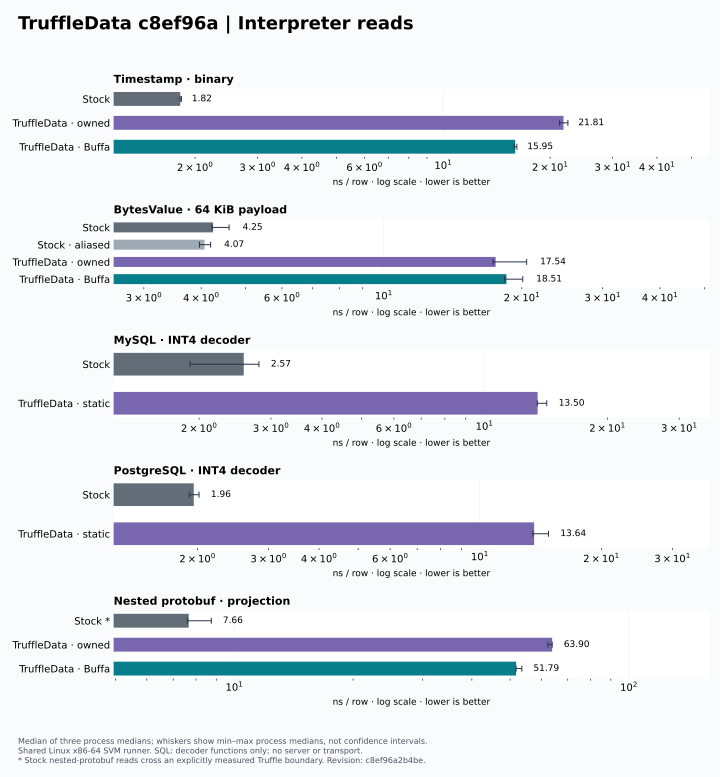
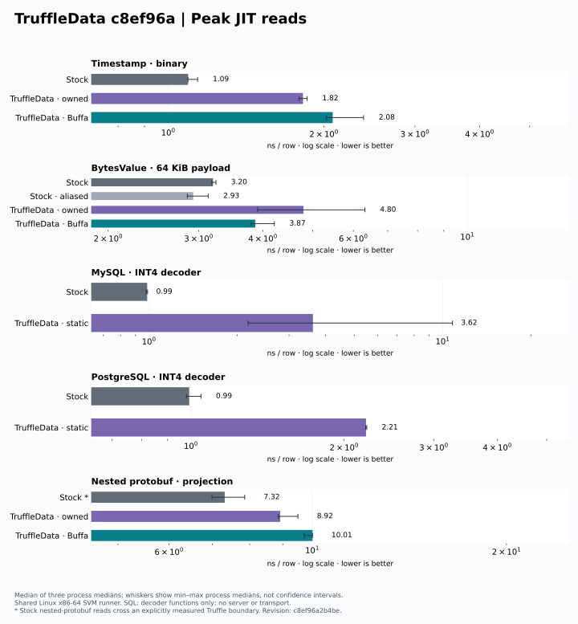
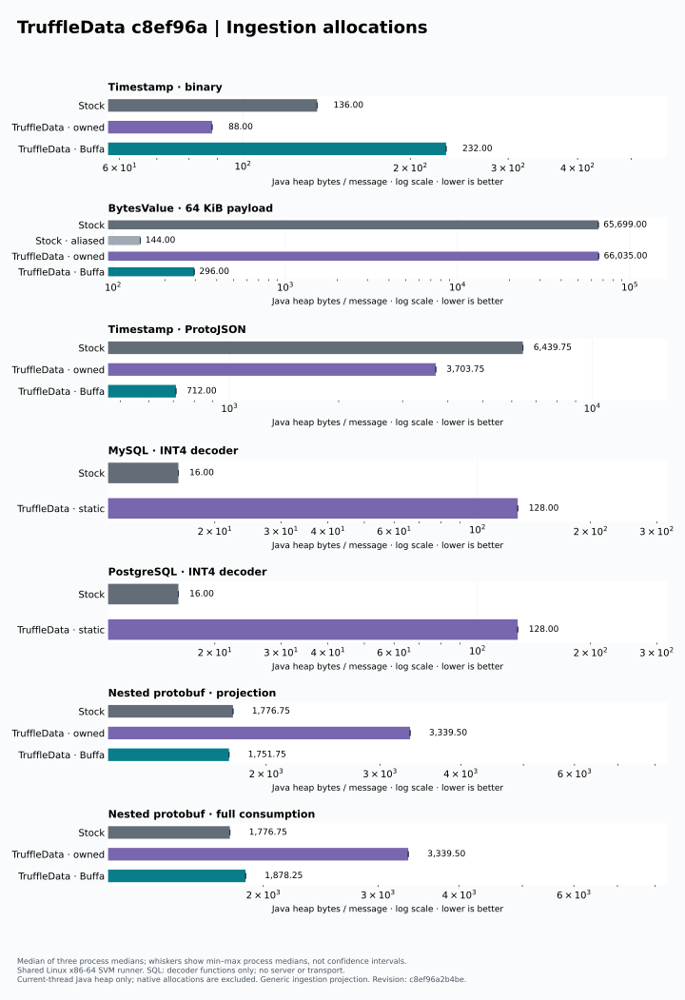
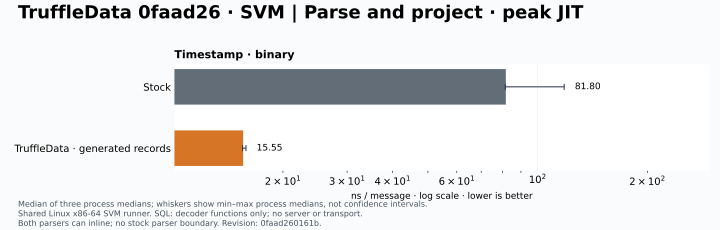
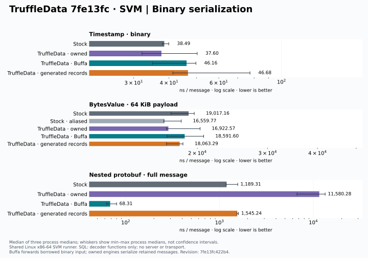

[](https://github.com/elide-dev/truffledata/actions/workflows/ci.yml)
[](https://app.codecov.io/gh/elide-dev/truffledata)
[](https://codspeed.io/elide-dev/truffledata)
[](https://github.com/elide-dev/truffledata/releases)
[](https://www.graalvm.org/)

**Bring data contracts into compiled guest code.** TruffleData gives Java and Elide
embedders schema-aware access to database results, protobuf messages, objects, and
sequences through GraalVM Truffle. Known types, presence, nullity, numeric widths,
and length constraints inform validation and specialized access.

[Get started](#choose-an-artifact) · [Architecture](#architecture) ·
[Contracts and samples](docs/CONTRACTS.md) · [Performance](#performance) ·
[Native Buffa integration](docs/BUFFA.md)

```java
Schema result = Schema.of(Field.requiredLong("a"));
try (JdbcCursor rows = JdbcSource.execute(
    connection, "SELECT a FROM t WHERE a > ?", List.of(100L), result, Limits.DEFAULT)) {
  Batch batch;
  while ((batch = rows.nextBatch()) != null) {
    consume(batch); // Immutable rows can outlive the cursor.
  }
}
```

Adapters supply contracts, optionally informed by a known query or protobuf schema.
Ingestion validates the data; Truffle specializes reads. The database executes and
plans SQL. TruffleData neither parses SQL nor translates guest callbacks into queries.

## Architecture



Owned rows retain validated facts. Live objects validate mutable values, and borrowed
views enforce ownership, thread confinement, and lifetime. Java null stays at annotated
ingestion boundaries; present null and missing fields have distinct representations.

Use the JVM or Native Image. The optional Myna/Buffa backend supports JVM FFM and
static SVM linkage, with Java fallback. The unreleased simdjson JSON backend supports
the same linkage without a Java fallback. The unreleased CSV backend is pure Java and
runs identically on both. Prebuilt native attachments target Linux x86-64.
See [representation and compilation guarantees](docs/TRUFFLE.md),
[ownership and native setup](docs/BUFFA.md), the [JSON backend](docs/JSON.md) and the
[CSV backend](docs/CSV.md).

## Choose an artifact

| Maven coordinate | Purpose |
| --- | --- |
| `dev.elide:truffledata-core` | Schemas, batches, static/dynamic objects, sequences and interop |
| `dev.elide:truffledata-jdbc` | Driver-independent JDBC ingestion and query contracts |
| `dev.elide:truffledata-jdbc-sqlite` | Native SQLite integration |
| `dev.elide:truffledata-jdbc-mysql` | MySQL Connector/J integration |
| `dev.elide:truffledata-jdbc-postgresql` | pgJDBC integration |
| `dev.elide:truffledata-protobuf` | Protobuf contracts, Java codec, runtime schemas and generated getters |
| `dev.elide:truffledata-protobuf-buffa` | Optional native parsing and borrowed typed views |
| `dev.elide:truffledata-protobuf-buffa-bindings` | Myna bindings, pulled in by the Buffa adapter |
| `dev.elide:truffledata-json` | Native simdjson JSON values, export, snapshots, typed plans and the static SVM backend |
| `dev.elide:truffledata-json-jvm` | JVM FFM backend for JSON; keep it off native-image classpaths |
| `dev.elide:truffledata-json-bindings` | Myna JSON bindings and value ABI, pulled in by the JSON adapter |
| `dev.elide:truffledata-csv` | Strict streaming CSV into immutable string and primitive column batches, typed plans and one-pass export; pure Java |
| `dev.elide:truffledata-bom` | Aligned libraries, drivers and runtime dependencies |

The runtime baseline is **Java 25** and **Elide GraalVM `25.5.5-elide.24`**.
Libraries are thin JARs; choose the adapters and guest runtimes your application needs.
Driver-specific artifacts bring their upstream drivers transitively.

```kotlin
repositories {
    mavenCentral()
    maven("https://maven.elide.dev")
    maven("https://maven.elide.dev/gvm-elide/25.5.5-elide.24")
}
dependencies {
    implementation(platform("dev.elide:truffledata-bom:0.7.0"))
    implementation("dev.elide:truffledata-core")
    implementation("dev.elide:truffledata-protobuf")
    // Add JDBC integrations or protobuf-buffa as needed.
}
```

[Release 0.7.0](https://github.com/elide-dev/truffledata/releases/tag/v0.7.0) includes
source JARs, consumer POMs, checksums, and Buffa native attachments. See
[publishing and consumption](docs/PUBLISHING.md) for Maven, Bazel and native linking.

Release **0.7.0** adds opt-in native-index typed views and cached shared primitive
access, with stronger compilation, lifetime and coverage checks. Native **ABI 8**
requires matching bindings and native libraries. The new
[shared-consumer measurements](benchmarks/results/shared-consumer/README.md)
show lower Java allocation for native views, but full native ingestion remains
1.86× stock latency in that fixture. Native memory is accounted for separately;
these results do not establish an overall performance win.

## Performance

The comparison suite measures **AOT, interpreter, peak guest JIT, and Java heap
allocation** on SVM. It compares our generic and generated access APIs with protobuf
Java, plus MySQL/Postgres INT4 decoder functions. All engines share one native executable.







<details>
<summary>Generic API comparisons, including MySQL and PostgreSQL</summary>







</details>

Measured implementation **`c8ef96a`**, included in **0.4.0**, on Elide GraalVM
`25.5.5-elide.24`. The 88-cell run uses three fresh timing processes and three separate
allocation processes per cell. Bars show medians; whiskers show minimum/maximum process
medians, not confidence intervals. Lower is better.

- Buffa nested interpreted reads: **51.79 → 22.58 ns/row** with generated getters.
- Owned generated scalar ingestion: **29.82 ns / 56 bytes**, versus stock **67.01 ns / 136 bytes**.
- Buffa scalar ingestion: **232 Java heap bytes** through the generic API, **200** through generated getters; the 0.3.0 generic baseline used **320**.
- Primitive-only SQL fixture ingestion: **128 bytes**, down from **160**.

Stock remains faster in several binary paths. General nested Buffa messages still
materialize rows and arrays. Java heap counts exclude native memory and compiler threads;
SQL cases measure decoder functions, not servers or complete queries. Buffa binary input
starts in unmanaged memory, and stock nested guest reads cross an explicit Truffle boundary.
Large owned-byte ingestion was noisy. See the [full results and methodology](docs/COMPARISON_BENCHMARKS.md),
[raw measurements](benchmarks/results/svm-comparison-c8ef96a/comparison.json), and
[measurement run](https://github.com/elide-dev/truffledata/actions/runs/41776420028).
Earlier runs remain available; these are workload-specific measurements, not performance guarantees.

### In development: independent protobuf runtime

Development code separates the descriptor-free runtime from the optional protobuf-java
bridge, adds a bounded descriptor-set compiler, and generates concrete scalar records,
builders and codecs. Buffa scalar decoding uses fixed native results without allocating
an index, and typed messages own their lifetimes directly.

Release **0.5.0** adopts **Myna 0.8.0**, adds native SIMD Unicode support,
and enforces detachment before scoped rows enter owned containers. Measured allocation
improvements are **128 → 80 bytes** for static-row fixtures and **104 → 24 bytes** for
compact scalar serialization (stock: **56 bytes**).

In the latest repeat, generated scalar parse/project at peak measures **24.9 ns versus
stock’s 115.1 ns**; Buffa Timestamp ProtoJSON measures **1.18 µs versus 10.26 µs**.
Generated nested full ingestion is **3.40 µs versus 2.12 µs**, and serialization is
**1.55 µs versus 1.19 µs**. Generic nested decoding remains behind at **14.54 µs**.
Shared-runner timings vary substantially between runs; both reports and their ranges
are retained. These changes ship in **0.5.0**. These shared-runner measurements predate the latest
[dedicated-host profiles and paired optimization results](docs/COMPARISON_BENCHMARKS.md#reusing-the-native-buffa-index); they are not new release measurements.

<details>
<summary>Development measurements and remaining gaps</summary>




See the [current 120-cell run and caveats](docs/COMPARISON_BENCHMARKS.md#current-generated-graph-comparison)
and the [independent runtime API and limits](docs/CONTRACTS.md#independent-protobuf-runtime-unreleased).
Concrete generated binary decoders and serializers cover nested/repeated schemas when every
reachable message has at most 64 fields. Editions, extensions and MessageSet remain unsupported.

</details>

## Protobuf and generated access

Provide schemas at build time with the Bazel/protoc contract generator, or compile
descriptors at runtime. Sources accept `MessageOrBuilder`, binary protobuf, ProtoJSON,
and protobuf text format; schemaless wire inspection is also available.

Generated `Access_` classes bind to a `ProtoPlan` and expose primitive getters, presence
checks, and array/bytes lengths for both owned and borrowed rows. Keep the accessor in
a final guest-node field so partial evaluation can fold its plan and field ordinals.
Reads retain contract and lifetime checks. See [generated getters](docs/CONTRACTS.md#generated-protobuf-getters)
and [executable integration samples](docs/CONTRACTS.md).

## Embedding JDBC

```java
Schema result = Schema.of(Field.requiredLong("a"));
try (JdbcCursor cursor = JdbcSource.execute(
    connection, "SELECT a FROM t WHERE a > ?", List.of(100L), result, Limits.DEFAULT)) {
  Batch batch;
  while ((batch = cursor.nextBatch()) != null) {
    Batch.Row row = batch.row(0);
    // Retained rows stay valid after advancing or closing the cursor.
  }
}
```

The supplied connection remains owned by the caller. The cursor owns its prepared statement and result set. SQL parameters use JDBC binding. A null contract requests conservative JDBC metadata inference. Explicit contracts bind by ordinal, so aliases and duplicate database labels are supported without reparsing SQL. Duplicate labels require ordinal access.

The extended overload accepts a `Decoder` and `StatementConfigurer`. These are the driver-cooperation points for Elide: configure fetch behavior, implement exact conversions, or supply a result-specific schema. PostgreSQL cursor fetching and MySQL streaming have driver/transaction requirements; the adapter never changes transaction policy on a borrowed connection. Local batching does not bound a driver's internal buffering.

Ingestion validates every contract. There is no unchecked “trusted” escape hatch. A null, missing field, unsupported value, or incompatible numeric conversion fails rather than manufacturing a default. Cursors are single-pass and thread-confined; batch and iterator consumption cannot be mixed. Closing a cursor releases pending rows, but already returned rows remain usable.

## Guest access

Elide can put a row or cursor into a guest binding without enabling Java host access. Rows implement member and ordinal access; JDBC cursors implement iterable/iterator messages and an explicit `close()` operation.

```js
for (const row of rows) {
  consume(row.a);
}
// Close explicitly when stopping early.
rows.close();
```

```python
for row in rows:
    consume(row.a)
```

The internal `DataLibrary` is for cooperating implementations. `ReadLongNode` provides a primitive read with a bounded schema/ordinal cache. It belongs beneath an adopted Truffle root or parent node; it is not a host-side replacement for the public interop API.

## Representations and semantics

| Representation | Ownership and specialization |
| --- | --- |
| `Batch` | Immutable snapshots; primitive INT64 columns, independent null/missing state |
| `StaticLayout` | Language-owned immutable records; final narrow integer, floating point and boolean properties |
| `DynamicRecord` | Live `DynamicObject` view; cached shape-aware access and validation of mutable values |
| `ProtoPlan` / `ProtoRow` | Lossless protobuf contracts, separate presence, compact scalars and generated access |
| Buffa `TypedRow` | Scoped borrowed typed views; inline small integer records and borrowed bytes |
| `JsonMessage` / `JsonSnapshot` | Scoped native JSON index or its immutable heap copy; ordered members, exact number tokens |
| `CsvBatch` / `CsvRow` | Immutable, unconfined CSV batches over retained input; string spans unescaped on read, primitive INT64/FLOAT64/BOOLEAN columns |
| `DataArray` | Sequences without a column schema |

`DataNull` is the interop null object; `Missing` is an internal presence marker.
Missing fields raise the appropriate interop access error. `ExactNumber` preserves
unsigned 64-bit integers and exact decimal values without silently rounding.

LOBs, vendor-specific JDBC values, dates/times and arbitrary host objects require
explicit adapter policies. Unsupported objects are rejected. RPC execution remains
extension work; protobuf text/JSON parsing is supported, and general JSON
([JSON backend](docs/JSON.md)) and CSV ([CSV backend](docs/CSV.md)) are in development.

## Build and verify

Bazelisk selects the pinned Bazel version. **Bazel is the only build system.**
Builds default to BuildBuddy Linux amd64 remote execution and caching, with pinned
JDKs, native toolchains and executor images. Keep credentials outside source control.

```sh
bazel build //core:core //jdbc:jdbc //protobuf:protobuf
bazel test //...
bazel test //tests:compiled --nocache_test_results
```

Gazelle generates source membership; dependency boundaries remain explicit. See
[Bazel setup](docs/BAZEL.md) for configuration, local execution and target generation.

Reusable CI workflows use pinned actions and runner hardening. They check:

- JSpecify/NullAway nullness, compiler warnings and positive/negative compiler probes.
- Contracts, presence, numeric precision, lifetimes, budgets, shape mutation and cache fallback.
- GraalJS/GraalPy interop, real MySQL/PostgreSQL servers, and native SQLite.
- JVM and SVM guest compilation, blocklist rejection controls, graph/AST budgets and allocation ceilings.
- Static native linking, Java fallback, publication consumers, Codecov coverage and JUnit reports.
- [Twenty CodSpeed simulation workloads](docs/BENCHMARKS.md), separate from the guest-JIT timing suite.

These gates exercise supported paths and enforce regression budgets. They do not certify
arbitrary downstream guest code or every deployment configuration. See [Truffle checks and scope](docs/TRUFFLE.md).

## Reference shelf

| Reference | What it covers |
| --- | --- |
| [Contracts and samples](docs/CONTRACTS.md) | Schemas, nullity, protobuf presence, generated access and integration examples |
| [Myna/Buffa](docs/BUFFA.md) | Native parsing, borrowed views, ownership, JVM and SVM setup |
| [JSON](docs/JSON.md) | simdjson backend, ownership, number policy, interop and embedder export |
| [CSV](docs/CSV.md) | Strict CSV contract, limits, typed plans, streaming, interop and export |
| [Truffle guarantees](docs/TRUFFLE.md) | Specialization, boundaries, compilation and allocation gates |
| [Comparison benchmarks](docs/COMPARISON_BENCHMARKS.md) | Raw results, charts, caveats and reproduction |
| [Continuous benchmarks](docs/BENCHMARKS.md) | CodSpeed simulation cases and methodology |
| [Build](docs/BAZEL.md) / [Publishing](docs/PUBLISHING.md) | Bazel, BuildBuddy, Maven artifacts and release operations |
| [TruffleCEL](https://github.com/elide-dev/trufflecel) | CEL evaluation with native TruffleData integration |
