# SVM comparison benchmarks

## Generated-access measurements

The [88-cell SVM run](https://github.com/elide-dev/truffledata/actions/runs/41776420028)
on implementation commit `c8ef96a2b4be` compares our generated getters with stock
protobuf Java. It uses three fresh timing forks and three separate allocation forks
per cell. [Raw JSON](../benchmarks/results/svm-comparison-c8ef96a/comparison.json) and
[full results](../benchmarks/results/svm-comparison-c8ef96a/comparison.md) retain the
original generic and typed API cases as well as the new generated cases.

| Ingestion projection | Stock ns/message | TruffleData ns/message | Stock / TruffleData Java heap bytes |
|---|---:|---:|---:|
| Scalar, owned generated getters | 67.01 | 29.82 | 136 / 56 |
| Scalar, Buffa generated getters | 67.01 | 161.51 | 136 / 200 |
| Timestamp JSON, Buffa generated getters | 3389.41 | 471.51 | 6439.75 / 712 |
| Nested protobuf, Buffa generated getters | 897.82 | 3198.47 | 1776.75 / 1751.75 |

Generated getters reduce Buffa nested interpreted reads from 51.79 to 22.58 ns/row
in the same run. Peak reads measure 10.01 versus 9.65 ns/row, with overlapping fork
ranges; this does not establish a peak-read improvement. Stock scalar peak reads
remain 1.09 ns versus owned 1.82 and Buffa 2.08; stock nested guest reads cross the
marked boundary. The aliased stock bytes baseline remains faster than Buffa
(51.13 versus 170.82 ns ingestion). General nested messages still materialize a
native index into rows and arrays; these results do not establish that the remaining
cost is in Buffa's parser itself.

The scalar native path skips general materialization state, temporary arrays and
boxed integers; both native backends reuse their result slot and release callback.
Existing generic Buffa scalar ingestion now uses 232 Java heap bytes versus 320 in
the 0.3.0 report; generated ingestion uses 200. Primitive-only static rows avoid a
payload tracker, reducing the SQL fixtures from 160 to 128 bytes. Native memory is
excluded from these Java heap counts. Timing ranges remain visible in the full
report, including noisy large-payload copies; the owned bytes generated-ingestion
result is especially unstable and should not be used to rank implementations.

An intermediate scalar storage union slowed ordinary bytes/nested reads. Separate
scalar rows, static library exports and final public accessors remove that dispatch
cost: ordinary Buffa peak reads measure 3.87 ns for bytes and 10.01 ns for nested
messages, versus 4.00 and 10.21 ns in the 0.3.0 run. These cross-run timings indicate
recovery, not a statistically established speedup. The earlier
[8fceec4 run](../benchmarks/results/svm-comparison-8fceec4/comparison.md),
[9c8a013 run](../benchmarks/results/svm-comparison-9c8a013/comparison.md) and
[repeat](../benchmarks/results/svm-comparison-9c8a013-repeat/comparison.md) remain
available, including their noisy results.

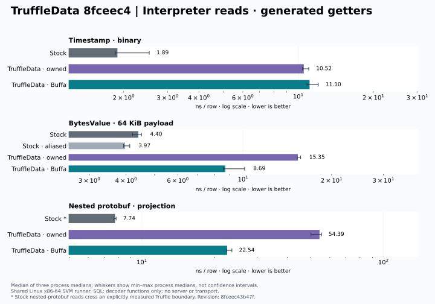

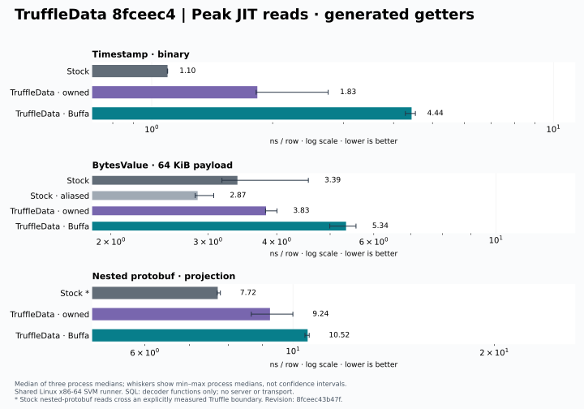

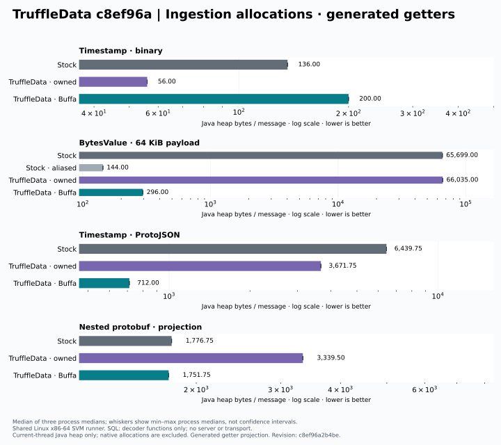

The same directory also contains generic-API charts and a provenance manifest.
The subsequent smoke-only allocation gates allow at most 240 Java heap bytes for
Buffa typed/generated scalar ingestion, 272 for generic scalar ingestion, and
4 bytes per retained read including guest arguments and the boxed batch checksum.
They do not change the timed measurement loop.

## Release 0.3.0 measurements

The [0.3.0 run](https://github.com/elide-dev/truffledata/actions/runs/41766750084)
passed all 62 cells on release commit `98a8c6304a40`, using Elide GraalVM
`25.5.5-elide.24`. Each cell has three fresh timing forks and three separate
allocation forks. [Raw JSON](../benchmarks/results/svm-comparison-0.3.0/comparison.json)
and the [full table](../benchmarks/results/svm-comparison-0.3.0/comparison.md) include
interpreter, peak JIT, ingestion, and direct AOT baselines. The
[0.2.0 baseline](../benchmarks/results/svm-comparison-0.2.0/comparison.md) remains available.

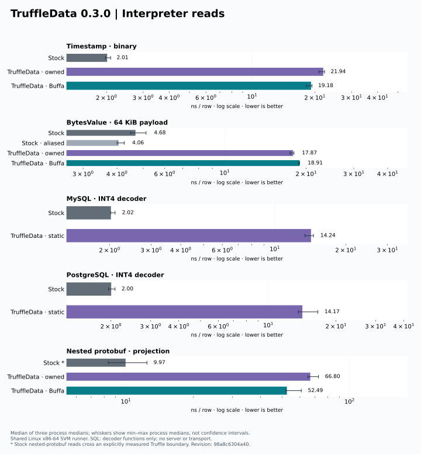

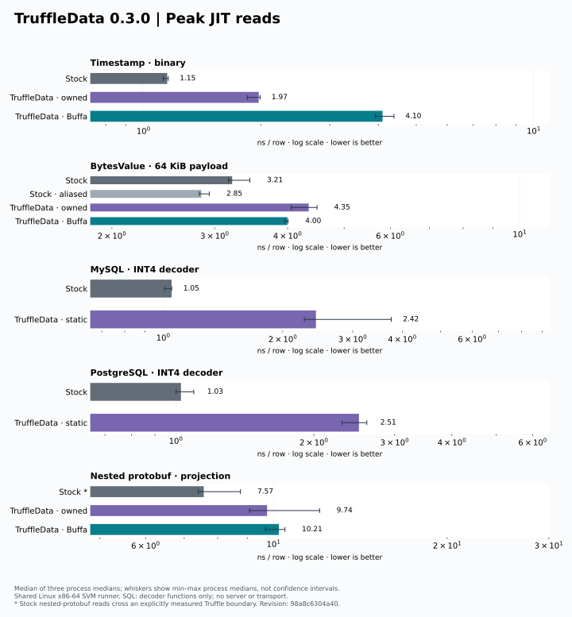

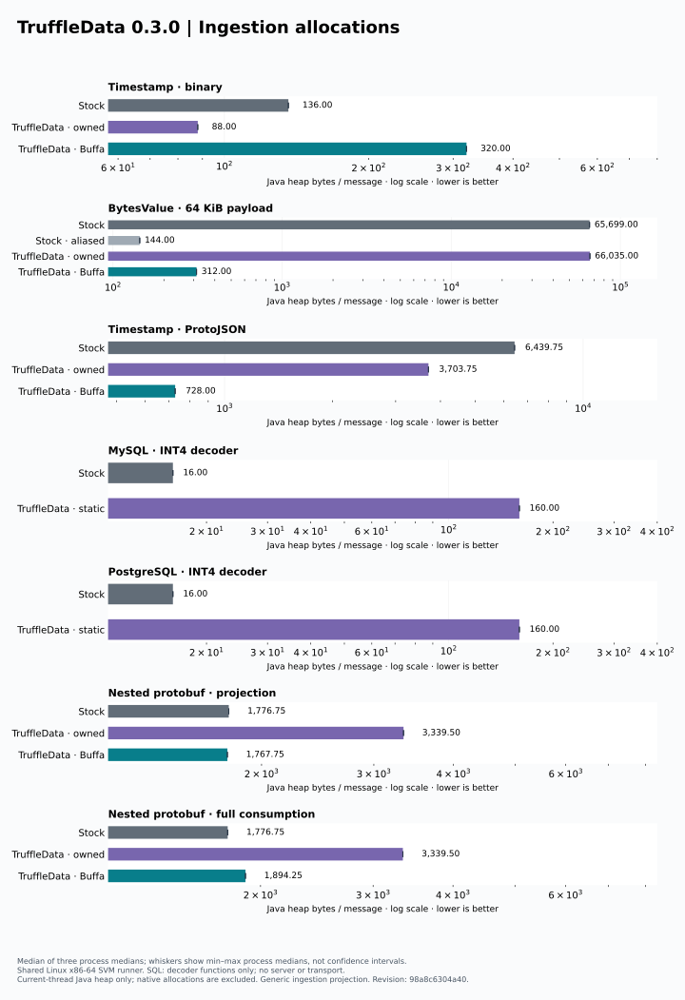

Buffa's nested-message projected ingestion uses 1,767.75 Java heap bytes/message,
versus stock's 1,776.75; full consumption uses 1,894.25 versus 1,776.75. These allocation
counts are unchanged from 0.2.0. Projected Buffa ingestion measured 3.88 µs/message
and full consumption 4.65 µs/message in this run. This does not establish a universal
performance win: stock remains faster in several paths, timings come from shared
runners, and Java heap counters exclude native memory. BytesValue ownership differs
between engines; the aliased stock baseline is shown explicitly. SQL cases measure
INT4 decoder functions, not servers, transport, or complete JDBC queries. Stock mixed
message guest reads use the explicitly marked boundary variant.

To regenerate the SVG/PNG graphics and provenance manifest:

```sh
python3 -m venv build/plot-venv
build/plot-venv/bin/pip install -r tools/bench/plot-requirements.txt
build/plot-venv/bin/python tools/bench/plot_comparison.py \
  benchmarks/results/svm-comparison-0.3.0/comparison.json docs/images --label 0.3.0
```

The [manifest](images/comparison-manifest.json) records the source data hash,
measured binary hash, revision, and plotting-library version. PNG copies are next
to the SVG files, and release assets include both formats.


This small suite compares TruffleData with protobuf Java's generated-message APIs and
stock MySQL/Postgres integer decoding. One SVM image includes all engines; each measured
cell runs in a fresh process. The default CI smoke checks correctness, execution tiers,
and allocation accounting. Full measurement is opt-in and needs no database servers,
Docker, JMH, or CodSpeed instrumentation.

```sh
# JVM/native correctness (Bazel builds and runs remotely on Linux amd64).
bazel test //benchmarks/comparison:smoke //benchmarks/comparison:native_smoke

# Three timing and three allocation processes per cell; force fresh measurements.
TRUFFLEDATA_BENCH_REVISION=$(git rev-parse HEAD) bazel test \
  //benchmarks/comparison:measure --nocache_test_results \
  --test_env=TRUFFLEDATA_BENCH_REVISION --test_output=errors
```

The measurement test writes `comparison.json` and `comparison.md` to its Bazel undeclared
outputs (`bazel-testlogs/benchmarks/comparison/measure/test.outputs/`; Bazel may zip them).
The **SVM comparison measurements** workflow runs the same target on demand and uploads
both files. On Linux amd64, a built image can also run directly:

```sh
python3 tools/bench/compare.py run --binary /path/to/truffledata-comparison \
  --revision "$(git rev-parse HEAD)" --output build/comparison
```

## Workloads and boundaries

| Workload | Stock baseline | TruffleData engines | Projection |
|---|---|---|---|
| `proto-scalar` | `Timestamp.parseFrom(byte[])` | owned static contract rows, Buffa scoped typed views | seconds + nanos |
| `proto-bytes` | `BytesValue.parseFrom(byte[])` with default copying, plus `stock-aliased` using immutable ByteString + `enableAliasing(true)` | owned static contract rows, Buffa scoped typed views | length of a 64 KiB payload |
| `proto-mixed` | `Type.parseFrom(byte[])` | owned contract rows, Buffa scoped typed views | UTF-16 name length + nested field count + oneof count + syntax enum |
| `timestamp-json` | reused `JsonFormat.Parser` into a generated Timestamp builder | descriptor-free Java parser, native WKT parser | seconds + nanos |
| `mysql-int4` | Connector/J `MysqlTextValueDecoder.getInt` | the same decoder followed by a static INT32 contract | integer value |
| `postgres-int4` | pgjdbc `ByteConverter.int4` | the same decoder followed by a static INT32 contract | integer value |

There are 32 varying rows/messages per batch. Checksums are independently computed from
fixture values and checked inside each measured batch. Rotation changes traversal order.
Stock SQL retained values are boxed scalar values; TruffleData uses static records.
The stock read loops use concrete generated protobuf getters or unbox retained scalars.

`ingest` includes parse/decode, row materialization, retention, a projected read and scoped
cleanup. Guest compilation is disabled; TruffleData projection uses the uncached data API.
`ingest-typed` adds six measurements using the primitive `DataLibrary.readLong` projection
for owned/Buffa scalar messages and Timestamp JSON, and static MySQL/Postgres integer rows.
The original generic `ingest` measurements remain. Byte-length projections already use the
typed interop length API and receive no duplicate measurement. Stock continues to use its
generated primitive getters. This separates library improvements from the effect of callers
choosing typed reads. Report schema 2 includes these cells; schema 1 remains readable.
Report schema 6 additionally compares our generated contract getters with stock generated
getters. `ingest-generated`, `read-generated-aot`, `interpret-generated`, and
`peak-generated` use the same projections and fixture rotation. The generated accessor
binds to a contract once, uses literal ordinals and primitive return types, and preserves
borrowed-message lifetime checks. These 26 additional cells bring the matrix to 88;
the original library-dispatch measurements remain available. JSON adds ingestion only.

Schema construction, parser construction, source creation and context startup are excluded.
For binary Buffa, source bytes already reside in unmanaged memory and the result borrows
that memory. Stock/owned parsers consume existing Java arrays and own their decoded payloads.
`stock-aliased` instead starts with an immutable ByteString and enables CodedInputStream
aliasing, retaining slices of that input; ByteString creation is setup, like native input
creation. This supplies a closer ownership baseline for Buffa’s borrowed byte views.
This is deliberately a comparison of those public APIs and ownership policies, not an
assertion of equal ownership or a measurement of copying data into native memory.

Retained-read stages exclude ingestion. `interpret` disables Truffle compilation;
`peak` warms and explicitly compiles the call target, requiring valid final-tier code before
and after every sample. Warmup exercises the measurement loop until the compiled target
remains valid, including after initial profile-driven deoptimizations. Performance warnings are errors and the Graal graph is bounded.
`read-aot` remains the direct stock SVM host baseline, excluding guest calls and contract
checks. Report schema 4 additionally runs stock getters in Truffle `interpret` and `peak`
roots with the same batch size, rotation, call arguments, boxed checksum return, warmup,
and tier assertions as TruffleData. These matched guest cases distinguish call/tier costs
from data-access costs; they do not add TruffleData contracts or interop to stock objects.
The direct AOT baseline remains in every new report. Older report schemas remain valid.
For mixed protobuf only, stock stages are labeled `interpret-boundary` and `peak-boundary`:
its collection getters make forbidden JDK methods reachable when exposed directly to guest
compilation ([failed build](https://app.buildbuddy.io/invocation/1914c4d8-1d9d-4b28-a1dc-a01690f88f2a)).
That projection therefore uses one boundary per row; its getter code remains AOT while the
guest loop compiles. Scalar, byte-length, and retained SQL stock getters remain directly
compilable. No blocklist entry or performance-warning check is disabled.
Timestamp JSON is ingestion-only because retained Timestamp reads are already covered
by `proto-scalar`.

MySQL/Postgres cases isolate actual driver decoding functions and retained data access.
They do **not** exercise ResultSet getters, JdbcSource adapters, connections, SQL, network,
or server execution, and cannot support a claim about query throughput. Existing
`//benchmarks/jdbc:drivers_smoke` and the JDBC JMH suite cover real drivers/servers separately.
No dependency upgrades or query-planning functionality are introduced by this suite.

## Measurement and limits

Each of 62 cells has three independent timing processes and three independent allocation
processes (372 short-lived processes). Each process records three samples. Timing uses
100 ms warmup and at least 50 ms per sample. Allocation uses fixed work: eight batches for
ingestion or 128 batches for retained reads, with one warmup batch of the same size.
Results report medians of process medians and the min/max process medians, not confidence
intervals. Job order is deterministically shuffled. Builds are cached; measurements are not.

Allocation uses `ThreadMXBean.getThreadAllocatedBytes`, including on SVM, and fails if an
escaped 1 MiB allocation does not advance the counter. It measures current-thread Java heap
bytes, including call/boxing overhead. It excludes native heap, compiler and background
threads; those allocations are **not zero** and should not be inferred from the chart/table.
This suite reports no RSS metric and establishes no total-memory or zero-allocation claim.

The image uses the pinned GraalVM toolchain with Serial GC, optimization level 2, four build
threads, static Buffa linkage, and the repository's Truffle blocklist checks. Raw results
record tool versions, binary hash, revision, host CPU/kernel, row checksums, backend and
execution tier. Missing samples, wrong backends/tiers and failed calibration invalidate the
run. Short samples on shared RBE hardware are diagnostics for these fixtures, not performance
guarantees; use a quiet pinned host and longer repeated experiments before tuning around
small differences.

## Initial measured baseline

[Raw samples](../benchmarks/results/svm-comparison-fa855f7/comparison.json) and the
[full comparison table](../benchmarks/results/svm-comparison-fa855f7/comparison.md) record
revision `fa855f7`. The 31-cell run took 34.5 seconds inside the remote test; native-image
build time is separate. These are short shared-hardware diagnostic measurements.

| Ingestion/projection | Stock default | Stock aliased | Buffa native |
|---|---:|---:|---:|
| Timestamp JSON | 8.24 µs / 6,440 B | — | 1.59 µs / 984 B |
| 64 KiB bytes | 51.04 µs / 65,699 B | 0.156 µs / 144 B | 0.791 µs / 568 B |
| Scalar protobuf | 0.149 µs / 136 B | — | 1.068 µs / 592 B |

Bytes here are current-thread Java heap allocation, excluding native heap. The aliased
protobuf-Java baseline is faster and allocates less Java heap than Buffa on this byte
fixture; the large advantage over default parsing mostly reflects avoiding payload copies.
Native Timestamp JSON has a clear advantage in this sample. Small scalar ingestion favors
stock generated protobuf. There is no across-the-board performance win.

Peak-JIT TruffleData retained reads were approximately 3.3–5.8× faster than its interpreter
reads across these fixtures. Direct stock AOT reads were still faster. For MySQL/Postgres
INT4 retained data, static TruffleData reads measured about 5.7/6.1 ns per row at peak,
versus 29.2/31.2 ns interpreted and 2.6/3.0 ns for direct stock scalar reads. This isolates
contract/guest-access costs and does not establish database-query performance.

## Decoder optimization checkpoint

Revision `5c7e528` ([samples](../benchmarks/results/svm-comparison-5c7e528/comparison.json),
[table](../benchmarks/results/svm-comparison-5c7e528/comparison.md)) removes eager unknown-field
buffers, shares empty unknown-field storage, and uses a bounded dense prefix for field-number
lookup. Sparse field numbers still use the map; the dense prefix is bounded by schema size
and capped at 4096 entries.

Owned scalar ingestion dropped from 616 to 496 Java heap bytes/message. In this run it took
490 ns/message versus stock's 99 ns/message, with stock allocating 136 bytes. Stock timings
also changed substantially from the initial run, so the absolute timing change between runs
must not be attributed entirely to these edits. This checkpoint does not meet stock parity.

A separate experiment made the generated static storage subclass the row itself. It passed
correctness and comparison smoke tests but failed the existing mixed-representation allocation
gate: four receivers caused 12 bytes/read instead of the allowed 0.05 bytes/read. Distinct
generated receiver classes saturated library dispatch earlier. The experiment was reverted;
the allocation gate and dispatch limits were not relaxed. Any future combined row/storage
representation must preserve polymorphic dispatch behavior as well as improve ingestion.

Revision `e194e54` ([samples](../benchmarks/results/svm-comparison-e194e54/comparison.json),
[table](../benchmarks/results/svm-comparison-e194e54/comparison.md)) additionally reuses
compiled field contracts and immutable empty native-view fields, and avoids slicing a freshly
wrapped byte array. Java heap allocation changes from the initial baseline are:

| Ingestion | Initial B/message | Updated B/message |
|---|---:|---:|
| Owned scalar | 616 | 448 |
| Buffa scalar | 592 | 400 |
| Buffa borrowed bytes | 568 | 392 |
| Buffa Timestamp JSON | 984 | 792 |

All original comparison cells and stock baselines remain. Core/protobuf regressions, Buffa
JVM acceptance, SVM smoke, and the full 31-cell measurement passed. Timing remains noisy:
owned scalar took 679 ns versus stock's 167 ns in this run; Buffa took 1012 ns. Allocation
improvements do not establish timing parity or superiority, and exclude native heap usage.

## Compact scalar records

Revision `71b4c16` ([samples](../benchmarks/results/svm-comparison-71b4c16/comparison.json))
adds compact storage and bounded direct decoding for one or two implicit-presence INT32/INT64
fields with zero defaults and single-byte tags. This applies by contract shape, not message
name. Unknown/mismatched fields and noncanonical tags fall back to the lossless decoder;
malformed values retain the existing rejection behavior. The generic ByteBuffer route is
covered as a differential oracle alongside generated protobuf Java messages.

Revision `0945211` ([samples](../benchmarks/results/svm-comparison-0945211/comparison.json),
[table](../benchmarks/results/svm-comparison-0945211/comparison.md)) moves compact reads into
Truffle specializations before delegated-library initialization. The unchanged generic
projection benchmark measured scalar ingestion at 80.59 ns and 88 Java heap bytes/message,
versus stock's 66.98 ns and 136 bytes. Retained peak reads measured 2.20 ns/row versus the direct
stock AOT lower bound of 1.39 ns/row. These results establish an allocation win for this case,
not a latency win. Other cells remain mixed and shared-host timings vary substantially.

The 78-test regression suite, compiled allocation tests, JIT matrix, Buffa JVM acceptance,
SVM smoke, and the full comparison run passed during these two revisions. No allocation or
JIT budgets were relaxed. The row class remains uniform across compact and general messages
so the previous generated-class dispatch regression is not reintroduced.

Revision `3507913` ([samples](../benchmarks/results/svm-comparison-3507913/comparison.json),
[table](../benchmarks/results/svm-comparison-3507913/comparison.md)) adds the six typed-ingestion
cells while retaining all 31 previous cells. Owned scalar ingestion measured 73.48 ns and
56 Java heap bytes with primitive projection, 75.93 ns and 88 bytes with generic projection,
and stock measured 64.17 ns and 136 bytes. Both TruffleData routes win allocation in this
fixture; neither establishes a latency win. The 37-cell SVM run and JVM/native smoke passed.

### Scoped lifetime and binary bookkeeping allocations

The `8696d83` and `8c3fbec` reports retain the complete 37-cell matrix. Cached
retained owners acquire a lifetime assumption before compilation; uncached and
megamorphic reads use ordinary lifetime checks. Close invalidates cached owners,
and the acceptance corpus checks constant receivers and cache saturation on JVM,
static SVM, and the SVM Java fallback. Binary decoding also avoids text-only
field tracking, and ordinary repeated fields no longer allocate a map.

Buffa scalar ingestion fell from 400 to 312 Java heap bytes per message, binary
bytes ingestion from 392 to 304, and Timestamp JSON from 792 to 720. These are
Java heap savings, not total native-plus-Java allocation figures. Timing varies
substantially between the short shared-hardware runs; stock aliased bytes and
stock driver decoding still lead. The native smoke enforces compact owned scalar
allocation budgets of 96 B for generic and 64 B for primitive projections.

The mixed binary fixture uses the ordinary-schema `google.protobuf.Type` message
with a Unicode name, 4–8 repeated nested field records, two oneof names, an enum,
and a nested source context. It uses the existing generated protobuf-java classes
without another Java code-generation toolchain. Report schema 3 adds ten cells;
the validator continues to accept complete schema 1 and 2 reports.

### Mixed-message materialization

Reports `fc91750` and `7285095` isolate empty repeated-field storage and UTF-8
materialization changes. Shared immutable defaults and lazy repeated-field lists
reduce owned mixed-message allocation from 3,847.50 to 3,562.50 B/message and
Buffa from 4,204.50 to 3,983.50 B/message. Avoiding sliced buffers, a charset
decoder, and an intermediate character buffer then reduces Buffa to 2,195.25 B.
The native parser still validates UTF-8 and budgets; Java materialization retains
bounds and lease checks. Empty borrowed arrays retain owner lifetime enforcement.
Stock remains lower at 1,776.75 B/message and faster at ingestion. Timings vary
across these short shared-machine runs, so allocation savings are the stronger
before/after evidence.

### Optional SVM profiling

Use `bazel test //benchmarks/comparison:profile --nocache_test_results` to capture
three fresh JFR processes per engine for mixed-message ingestion. Each process
runs eight diagnostic rounds with Serial GC. Use the separate
`//benchmarks/comparison:profile_epsilon` target for a no-GC probe with one round
per process and a 1 GiB heap cap. Both targets also collect matched one-round
fresh-process timings with recording off (`*.unprofiled.jsonl`); `gc.txt` labels
the collector. These ingestion-only diagnostics supplement the full comparison.

This toolchain rejects signal-handler sampling when Truffle runtime code installation
is enabled. The recordings therefore use the safepoint sampler: distributions are
biased toward safepoint locations and are clues for experiments, not unbiased CPU
percentages. Runtime code installation and normal peak-JIT checks remain enabled. Select another
workload with `--test_arg=proto-scalar` (or another comparison workload). Raw
recordings and diagnostic output are under the test's `test.outputs` directory.
Pass `--test_env=TRUFFLEDATA_BENCH_REVISION` with the current commit in the environment
to preserve revision provenance; the binary SHA-256 is recorded automatically.

The separate manual `svm_profile` image enables
[GraalVM JFR](https://www.graalvm.org/latest/reference-manual/native-image/debugging-and-diagnostics/JFR/).
Normal comparison images and scores remain uninstrumented. The custom configuration
collects CPU and sampled Java allocations; profile timings are diagnostic, and
allocation samples are not exact byte counters or native allocation measurements.
Use `jfr print --json --stack-depth 128 --events jdk.ExecutionSample,jdk.ObjectAllocationSample FILE.jfr`
to inspect a recording, filtering stacks to `Comparison$Fixture.ingest` when
attributing ingestion costs rather than setup. Native Rust internals may not be
resolved by the Java stack sampler.

The first paired GC probe is recorded in `benchmarks/results/svm-gc-probe-ed52cde`.
Both targets pass. Recording-off median ingestion times (Serial / Epsilon) were
1.64 / 24.08 µs for stock, 17.51 / 16.93 µs for owned, and 5.25 / 5.81 µs for Buffa.
Stock's Serial forks ranged from 0.99 to 24.48 µs, so this is diagnostic evidence,
not an isolated measurement of collector pause cost or a production win under Epsilon.
The profiler cannot provide unbiased CPU percentages with this Truffle runtime.

Run `python3 tools/bench/profile_summary.py RECORDING_DIRECTORY` to reproduce
summaries with source recording hashes, sample counts, ingestion filtering, and a
safepoint-dominance flag. The raw JFR files remain test artifacts in the linked
BuildBuddy invocation; the repository stores summaries and full recording-off timing
samples. No recording's absence of allocation samples is interpreted as zero allocation.

Report schema 5 adds `proto-mixed-full` ingestion for stock, owned, and Buffa. It uses the
same mixed messages but consumes every populated field, including all nested field names,
numbers, kinds, cardinalities, packed flags, oneof strings, and the source filename. This
checks the materialization cost when consumers read the whole message. Compiled-plan setup
and warmup remain excluded; adaptive native string hints have seen the projection before
measured samples. It is not a first-message or cold-plan measurement. Existing schemas and
all prior comparison cells remain supported.

## Development: generated records and parse/project fusion

Schema 7 adds generated owned scalar records and matching binary serialization cases.
Schema 8 adds scalar parse-and-project without retaining the message, but used an explicit
boundary for stock parsing. Schema 9 removes that stock parser boundary: both engines can
inline parsing and projection into the guest compilation. Only invalid-input exception
construction crosses a cold boundary. The isolated `//tests/jit-negative:stock_parse_test`
probe verifies that stock parsing actually executes at the last compiled tier in SVM with
fatal performance warnings and a 10,000 graph-size budget. The full SVM comparison uses
that same budget and requires every peak cell to compile. On HotSpot, the full stock
parse/project root exceeded even an experimental 200,000 budget. The JVM smoke test reports
that specific graph-size bailout as an unsupported capability; it does not substitute a
boundary score. Other failures still fail the test, and SVM does not permit this exception.
Do not interpret schema 8 results as stock's best fused JIT result.

Generated records and generic owned rows are separate engines. Buffa's binary scalar path
uses a fixed native output slot and has a dedicated zero-native-allocation test. Benchmark
Java allocation counters still exclude native allocations in other workloads; they do not
imply that all Buffa ingestion is allocation-free.

Schema 10 gives concrete generated records the same direct getter loops as stock records
for retained AOT/interpreter/JIT reads, without the generic projection adapter used in
schemas 7–9. Schema-bound generic and borrowed getter measurements remain separate cases.
Removing an explicit parser boundary allows inlining; a compiled root alone does not prove
that every stock parser helper was inlined. The measurements report the resulting operation,
including any calls the SVM compiler elects to retain.

## Measured independent-runtime development snapshot

Revision `4b4661c` is unreleased. The [first run](../benchmarks/results/svm-comparison-4b4661c/comparison.json)
and [one repeat](../benchmarks/results/svm-comparison-4b4661c-repeat/comparison.json) each cover
111 cells with three timing processes and three separate allocation processes per cell.
The repeat followed concurrent CI work; timing remained variable, so both runs are retained.
Charts below use the first run consistently, rather than selecting the better result per case.

| Scalar operation | Stock ns, first / repeat | Generated record ns, first / repeat | Stock / generated Java bytes |
| --- | ---: | ---: | ---: |
| Retained ingestion | 92.47 / 105.07 | 33.29 / 33.88 | 136 / 80 |
| Interpreter reads | 2.83 / 4.38 | 1.64 / 2.13 | 2 / 2 |
| Peak reads | 1.18 / 1.52 | 1.98 / 1.55 | 1 / 1 |
| Binary serialization | 22.28 / 27.14 | 39.81 / 38.98 | 56 / 40 |
| Fused parse/project, peak | 80.96 / 64.62 | 14.28 / 13.45 | 137 / 1 |

The generated records improve ingestion and whole-operation projection here; they do not
win every operation. Stock still leads scalar serialization and general nested ingestion.
The small retained-read differences should be read with the process ranges, not as a
universal ranking. Parse/project heap counts include guest-call overhead; the separate
compiled allocation test records 32 bytes across 100,000 generated projections.

Buffa scalar ingestion now uses **112 Java bytes**, or **80** with generated access, compared
with **240 / 208** at `7b4eb4a`. Both current runs report those same allocation counts.
The fixed scalar native decoder also passes an allocator-instrumented zero-allocation test.
Other Buffa shapes may still allocate a native index; Java heap counters do not include it.
Native input/schema and reusable decoder scratch are not per-message index allocations.

Generic 64 KiB byte serialization now uses a bulk copy: approximately 5.3 / 6.7 µs in the two
current runs, versus approximately 417 µs in the earlier `7b4eb4a` run. Large byte timings
have wide ranges on shared runners. Binary Buffa serialization forwards input, whereas
owned engines serialize message storage; these remain explicitly different operations.

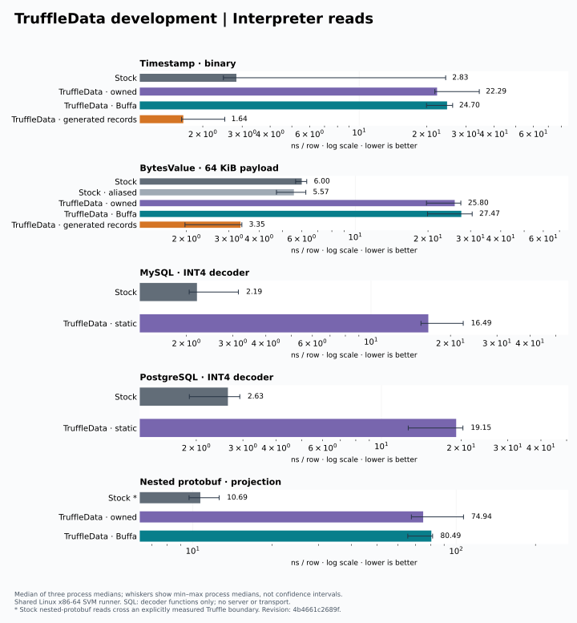
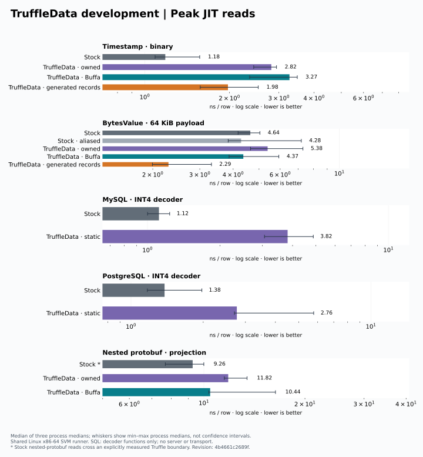
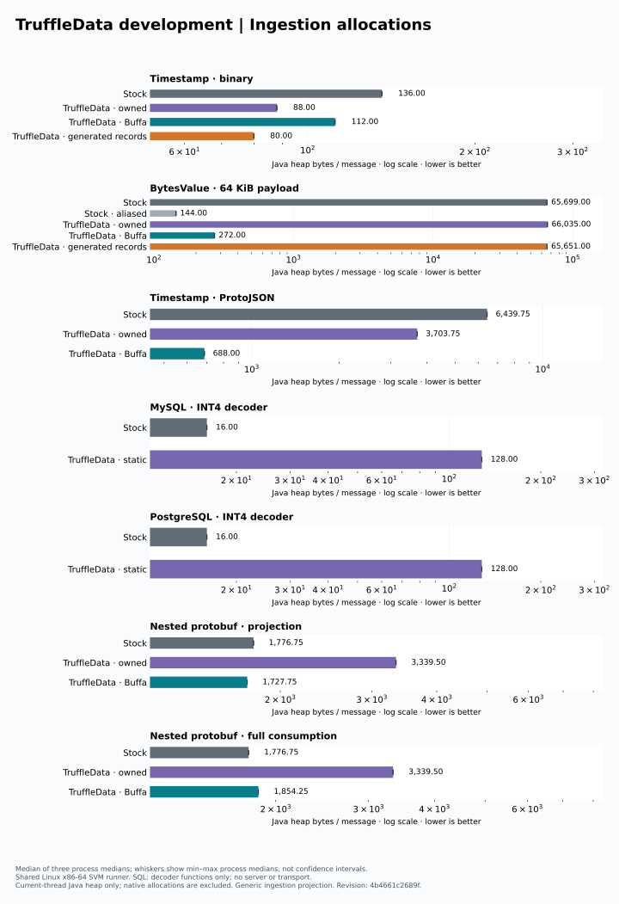
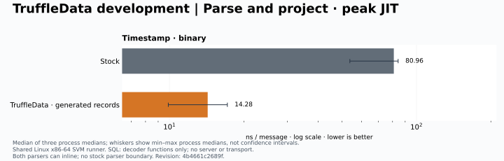
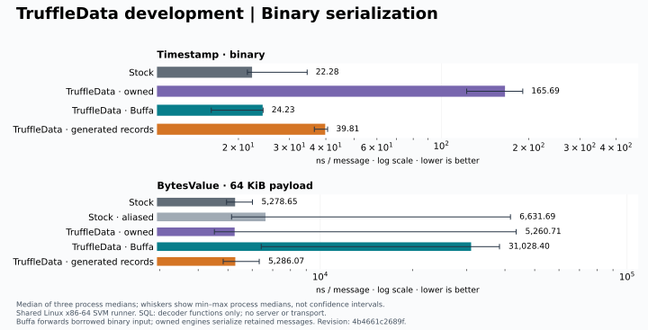

The [chart manifest](images/independent/comparison-manifest.json) records the source-data
hash, executable hash and implementation revision. The [validation and measurement run](https://app.buildbuddy.io/invocation/6156aff1-0dc2-4795-a235-80cbc6764654)
passed native/fallback tests, both published native consumers, comparison smoke and the full
matrix; the [repeat](https://app.buildbuddy.io/invocation/591882d2-8724-4140-ae77-4373b7b52dfe)
uses the same executable revision. Release 0.4.0 charts above remain unchanged.

## Generated graph decoding and scalar serialization

The unreleased [`9e0736a` run](../benchmarks/results/svm-comparison-9e0736a/comparison.json)
adds schema 11: 120 cells, including concrete generated nested/repeated decoding, full
consumption of the mixed message, and matched mixed-message serialization for every engine.
Each cell has three timing forks and three separate allocation forks. This is one complete
run on shared hardware; the process ranges overlap in some cases, so the small differences
need repeat measurements. Earlier raw results and charts remain available above.

| Operation | Stock | Generated owned | Stock / generated Java bytes |
| --- | ---: | ---: | ---: |
| Scalar ingestion | 95.90 ns | 39.40 ns | 136 / 88 |
| Scalar interpreter reads | 2.71 ns | 2.03 ns | 2 / 2 |
| Scalar peak reads | 1.83 ns | 1.80 ns | 1 / 1 |
| Scalar serialization | 33.44 ns | 21.93 ns | 56 / 24 |
| Scalar parse/project, peak | 67.97 ns | 13.81 ns | 137 / 1 |
| Nested ingestion, full consumption | 1.30 µs | 1.08 µs | 1776.75 / 1895 |
| Nested serialization | 0.96 µs | 4.07 µs | 436.50 / 1130.50 |

Concrete generated decoders remove the generic row construction path for nested/repeated
messages. In this run, generic owned full-consumption ingestion takes 17.67 µs and Buffa
takes 7.24 µs; the generated path takes 1.08 µs. It is close to stock in time, but allocates
6.7% more Java heap. It does not establish a win for generic decoding or borrowed views.
Nested generated records still use the generic serializer, which remains a clear gap.

The specialized scalar serializer now caches encoded size and writes directly into an
exact-size output array. Serialization allocation falls from 40 to 24 bytes per message.
The size cache adds eight bytes to the retained scalar record on this SVM layout, so
scalar ingestion rises from 80 to 88 bytes. Peak retained reads are effectively tied.

[Validation and measurement](https://app.buildbuddy.io/invocation/0b656af7-5f01-4e01-9c2e-371b437dec75)
passes JVM tests, comparison smoke, the 120-cell SVM measurement, and the full native
access matrix (511 cases). Generated guest reads pass fatal performance warnings,
blocklist checks, the 10,000 graph-size budget, and the retained-read allocation gate.
Shape-specific comparison roots and class-profiled interface receivers are required for
SVM compilation; the failed preceding run is not presented as a completed matrix.
The separate protobuf-free native consumer also passed before this measurement.

SQL decoder wrappers and stock's aliased-byte decoder still expose overhead to address;
the objective of matching stock across the supported contexts is not complete. Native
allocation remains outside the Java heap counters. See the raw report for every case,
process range, and borrowing/copying distinction.

The next [`2fae8de` run](../benchmarks/results/svm-comparison-2fae8de/comparison.json)
keeps the same 120 cells and adds direct generated graph serializers and narrow decode-state
fields. Generated nested serialization moves from 4.07 µs / 1130.50 bytes to 1.45 µs /
192.50 bytes. Stock in that run measures 0.67 µs / 436.50 bytes: the generated writer now
allocates less, but is still slower. Nested decode allocation drops from 1895 to 1800.50
bytes, versus stock's 1776.75. Full-consumption generated decoding measures 0.97 µs versus
stock's 1.15 µs, with overlapping process ranges. Generic serialization also avoids temporary
UTF-8 arrays; its nested serialization allocation falls from 1130.50 to 556 bytes.
[The complete native run](https://app.buildbuddy.io/invocation/d7d680e7-ccd7-4b6c-b5e0-a06e0a6fa1a4)
passes the comparison, both native access gates, and the protobuf-free native consumer.

## Decoder size proof comparison

The [`8fc6670` measurement](../benchmarks/results/svm-comparison-8fc6670/comparison.json)
reuses decoder-proven encoded sizes for eligible generated graphs. All 120 cells remain in
the matrix. This is a separate shared-runner run; compare engines within each run and keep
the process ranges. Scalar code was unchanged, but its timings also shifted, illustrating
why cross-run timing differences alone cannot establish an optimization's effect.

| Operation | Stock | Generated owned | Stock / generated Java bytes |
| --- | ---: | ---: | ---: |
| Scalar ingestion | 58.82 ns | 22.09 ns | 136 / 88 |
| Scalar interpreter reads | 2.04 ns | 1.22 ns | 2 / 2 |
| Scalar peak reads | 1.05 ns | 1.31 ns | 1 / 1 |
| Scalar serialization | 17.80 ns | 17.87 ns | 56 / 24 |
| Scalar parse/project, peak | 54.07 ns | 10.61 ns | 137 / 1 |
| Nested ingestion, projection | 758.37 ns | 801.80 ns | 1776.75 / 1800.50 |
| Nested ingestion, full consumption | 844.77 ns | 909.58 ns | 1776.75 / 1800.50 |
| Nested serialization | 537.77 ns | 1139.49 ns | 436.50 / 192.50 |

Generated nested decoding is close to stock here, with 1.3% more Java heap allocation.
Generated nested serialization uses 56% less Java heap, but is about 2.1 times slower.
Its per-process medians range from 652.84 to 1306.07 ns, versus 506.59 to 719.78 ns for stock.
Generic owned nested full-consumption decoding still takes 9.69 µs and 3339.50 bytes; this
work has not closed the generic, borrowed, aliased-byte, or SQL-wrapper gaps.

The size proof stays immutable in spare presence bits for schemas with at most 32 fields.
No cache field or per-message cache object is added. Duplicate/merged singular fields,
oneof replacement, maps, known groups, packed/unpacked conversions, omitted defaults,
truncating varints and nonminimal varints conservatively disable reuse. Wider schemas
retain all presence bits and use generated sizing. The decoder's nonnegative work counter
uses its sign bit for proof validity while retaining its full Long.MAX_VALUE budget range.
Tests exercise these conditions, presence above bit 31, canonical-expansion limits, and
4096 deterministic wire mutations. Graph bindings validate reachable schemas at setup.

[The complete SVM cycle](https://app.buildbuddy.io/invocation/14c55ec3-9859-4b7f-9482-bb5219a8a228)
passes the full benchmark, comparison/native access gates, and the protobuf-free native
consumer. CI also passed on implementation revision `8fc6670`, including native/fallback
acceptance, real driver acceptance, coverage, JUnit reporting, and CodSpeed reporting.

## Generic immutable storage comparison

The [`0faad26` run](../benchmarks/results/svm-comparison-0faad26/comparison.json)
keeps every one of the 120 comparison cells. Generic snapshot accounting now traverses
validated static/column storage directly, with strict-mode checks for transparent
facades. The decoder also owns its state arrays directly instead of allocating a public
builder for each message. Required fields, normalization, ownership and all existing
budgets remain enforced.

| Operation | Stock | Generated owned | Stock / generated Java bytes |
| --- | ---: | ---: | ---: |
| Scalar ingestion | 157.34 ns | 69.45 ns | 136 / 88 |
| Scalar interpreter reads | 3.17 ns | 3.20 ns | 2 / 2 |
| Scalar peak reads | 3.05 ns | 2.53 ns | 1 / 1 |
| Scalar serialization | 32.82 ns | 43.62 ns | 56 / 24 |
| Scalar parse/project, peak | 81.80 ns | 15.55 ns | 137 / 1 |
| Nested ingestion, projection | 1474.16 ns | 2308.47 ns | 1776.75 / 1800.50 |
| Nested ingestion, full consumption | 1429.60 ns | 1985.01 ns | 1776.75 / 1800.50 |
| Nested serialization | 1022.12 ns | 1768.83 ns | 436.50 / 192.50 |

Generic nested full-consumption decoding measures 9.80 µs and 3086.50 Java bytes,
versus stock's 1.43 µs and 1776.75 bytes. Its allocation falls from 3339.50 bytes in
`8fc6670` to 3213 bytes in the preceding
[`0105fcb` run](../benchmarks/results/svm-comparison-0105fcb/comparison.json), then to
3086.50 here: a 7.6% total reduction. Owned byte-message ingestion saves another 16 bytes
in this batch. Those are allocation results, not proof of an isolated timing improvement.
The latest two runs used Intel Xeon workers; `8fc6670` used AMD EPYC. Even on the same
reported CPU model, process timing ranges remain broad. All raw results are retained.

Generated nested decoding allocates 1.3% more than stock and is 39% slower in this run.
Generated nested serialization allocates 56% less, but is 73% slower. Scalar retained
interpreter/peak read ranges overlap. This does not establish parity across contexts:
generic decoding, Buffa borrowing, aliased bytes, and SQL wrappers still have gaps.

[The complete SVM cycle](https://app.buildbuddy.io/invocation/87da3b8e-daca-4062-a526-63392b00d824)
passes the 120-cell comparison, both native access gates (including the 511-case matrix),
and the protobuf-free native consumer. The
[JVM coverage cycle](https://app.buildbuddy.io/invocation/f7b31a8f-aab0-486f-afee-9c81ebbff773)
passes the correctness suite, native-enabled JVM acceptance and disabled-native-access
fallback. Access-method coverage passes; PayloadBudget has 48/48 covered lines and
5/5 covered methods. Exact cell, string, parent and depth boundaries, compact scalar
fallback, facade/schema mismatches, merges, defaults and map deduplication are exercised.
The [Gazelle drift gate](https://app.buildbuddy.io/invocation/6603031e-78e7-4bb9-ae2e-06e82306d0f0)
also passes. CI on this implementation revision is tracked separately from these local
RBE results.

## Packed presence comparison (`fa89f1f`)

The [`fa89f1f` run](../benchmarks/results/svm-comparison-fa89f1f/comparison.json)
packs generic protobuf presence into one inline word, with spill words only above
64 fields. Compact integer rows use that word for their first value and reuse their
boxed second value for generic reads. The same 120 measurement cells remain.

| Operation | Stock | Generated owned | Stock / generated Java bytes |
| --- | ---: | ---: | ---: |
| Scalar ingestion | 119.28 ns | 40.71 ns | 136 / 88 |
| Scalar interpreter reads | 3.72 ns | 2.64 ns | 2 / 2 |
| Scalar peak reads | 1.63 ns | 2.66 ns | 1 / 1 |
| Scalar serialization | 32.82 ns | 52.00 ns | 56 / 24 |
| Scalar parse/project, peak | 81.45 ns | 20.52 ns | 137 / 1 |
| Nested ingestion, projection | 1307.37 ns | 1638.80 ns | 1776.75 / 1800.50 |
| Nested ingestion, full consumption | 2120.11 ns | 1591.31 ns | 1776.75 / 1800.50 |
| Nested serialization | 968.58 ns | 1365.33 ns | 436.50 / 192.50 |

Generic scalar ingestion now allocates 64 bytes (previously 88); primitive projection
allocates 48 (previously 56). Generic scalar serialization drops from 136 to 104 bytes,
but still takes 156.17 ns versus stock's 32.82 ns. Generic nested ingestion falls from
3086.50 to 2976 bytes, a 3.6% reduction in this batch and 10.9% from the earlier 3339.50
baseline. Its full-consumption time is 11.30 µs versus stock's 2.12 µs. Owned byte-message
ingestion drops another eight bytes. Timestamp ProtoJSON ingestion allocates 3655.75
bytes versus stock's 6439.75.

Generated-code allocation is unchanged by this generic representation change. Stock
still has faster scalar peak reads and scalar/nested serialization in this run. Generated
nested full parsing is faster here, but process ranges overlap. The last three runs
report the same Intel Xeon model; process timing ranges are still broad, and earlier
AMD runs are kept separately. Compare engines within a run and retain those ranges;
the allocation changes do not prove isolated timing improvements or universal parity.
Generic decoding, several Buffa paths, aliased bytes and SQL wrappers remain behind.

[All six validation targets pass](https://app.buildbuddy.io/invocation/276b73c0-b8ab-4e3c-bb31-6f9c63f9a02c):
the full comparison, comparison/native access gates, protobuf-free native consumer,
compiled JVM allocation gate and Gazelle drift. The native matrix now has **603 cases**:
all previous 511 plus 92 for presence/read access across word boundaries and wide oneof
transitions. Every success case executes compiled code under unchanged warning, graph
and allocation limits. The
[coverage cycle](https://app.buildbuddy.io/invocation/edebd856-2684-4be7-b5d5-614e5c12071c)
passes correctness and both Buffa JVM routes, with 37/37 ProtoRow methods covered.
Stock-oracle tests cover empty through 256-field schemas, defaults, required fields,
unknown fields, text/JSON, buffer input and retained builder snapshots. The compiled
JVM gate measures compact integer decoding at 40 bytes for one integer or a cached
second integer, and 64 bytes for a noncached second integer; limits are 48/72 bytes.

## Compact integer serialization comparison (`f564926`)

The [intermediate run](../benchmarks/results/svm-comparison-f564926/comparison.json)
measures direct INT32/INT64 serialization at 29.95 ns / 24 bytes, versus stock's
35.21 ns / 56 bytes. The previous generic encoder allocated 104 bytes. This path
writes one exact-sized output array, including preserved unknown bytes, and checks
canonical output budgets before allocation. It also writes compact nested integers
directly into their parent's output. Stock timing had a large process outlier;
allocation is the stronger evidence for this change.

## Current generated graph comparison

The [`7fe13fc` repeat](../benchmarks/results/svm-comparison-7fe13fc-repeat/comparison.json)
measures the primitive static-row factory, bound compact getters, scoped-row ownership
checks, and Myna **0.7.2** with native SIMD Unicode support. The 120 measurement cells,
three timing processes and separate allocation processes per cell remain unchanged.

| Operation | Stock | TruffleData | Stock / TruffleData Java bytes |
| --- | ---: | ---: | ---: |
| Scalar ingestion, generated records | 152.26 ns | 82.50 ns | 136 / 88 |
| Scalar interpreter reads, generated records | 4.78 ns | 2.36 ns | 2 / 2 |
| Scalar peak reads, generated records | 1.85 ns | 3.48 ns | 1 / 1 |
| Scalar serialization, compact runtime | 38.49 ns | 37.60 ns | 56 / 24 |
| Scalar serialization, generated records | 38.49 ns | 46.68 ns | 56 / 24 |
| Scalar parse/project, generated peak | 115.11 ns | 24.86 ns | 137 / 1 |
| Nested ingestion, generated projection | 2008.56 ns | 2749.02 ns | 1776.75 / 1800.50 |
| Nested ingestion, generated full consumption | 2121.08 ns | 3399.59 ns | 1776.75 / 1800.50 |
| Nested serialization, generated records | 1189.31 ns | 1545.24 ns | 436.50 / 192.50 |
| Timestamp ProtoJSON, Buffa | 10264.59 ns | 1182.60 ns | 6439.75 / 688 |
| MySQL INT4 fixture, static rows | 129.13 ns | 284.40 ns | 16 / 80 |
| PostgreSQL INT4 fixture, static rows | 74.41 ns | 242.05 ns | 16 / 80 |

The static-row fixtures allocate **80 bytes**, down from **128**: `createLong` avoids
boxing, varargs and generic staging while keeping width/range checks and presence
states. This measures driver decoder functions plus retained named rows, not complete
JDBC queries; normal JDBC cursors still use their general field-source path.
Compact scalar serialization stays at **24 bytes**, versus the earlier **104**.
Generic scalar ingestion remains 64 bytes, or 48 with primitive projection. Generic
nested ingestion remains **2976 bytes** and takes **14.54 µs**, versus stock's
**2.12 µs / 1776.75 bytes**. Generic nested serialization and several borrowed/SQL
paths also remain behind stock.

The [first run](../benchmarks/results/svm-comparison-7fe13fc/comparison.json) and repeat
have **identical executable hashes**. The first used AMD EPYC; the repeat used Intel
Xeon 3.10 GHz. Shared-worker timing ranges are broad and results disagree: generated
nested full ingestion was 1.82 µs versus stock's 1.81 µs in the first run, and
3.40 µs versus 2.12 µs in the repeat. Generated scalar peak reads ranged from
3.06–8.95 ns in the first run and 1.97–3.64 ns in the repeat. The charts use the
latest repeat, including its slower results; both complete reports are retained.
Compare engines within each run, inspect process ranges, and use the stable allocation
changes without treating these timings as universal parity or isolated speedups.

[All eight SVM targets pass](https://app.buildbuddy.io/invocation/f0a47a85-8946-4033-85c0-c6c922943eac):
the comparison and access gates, native-enabled/native-free Buffa acceptance, published
native consumers with/without protobuf-java, and Gazelle drift. The checked native
inventory has **617 cases**, including all previous 603 plus signed-width, nullable
construction and overflow cases. Every success case executes compiled code under the
existing fatal warnings, graph and allocation budgets. The
[repeat comparison](https://app.buildbuddy.io/invocation/e77c77de-a03d-4939-8163-1a4f749fa0f3)
also passes with the same binary. The
[compiled JVM/release-consumer cycle](https://app.buildbuddy.io/invocation/d403e358-1cdc-4059-a727-d38859754bb4)
passes; temporary constructed-and-read static rows measure **0.00112 bytes/row**
against the 0.05-byte ceiling.

The [coverage cycle](https://app.buildbuddy.io/invocation/bb427397-c46b-433c-a025-0f344e09beba)
covers all methods in ProtoCodec (34/34), ProtoRow (38/38), TypedRow (17/17),
ViewOwner (7/7), AbstractRow (13/13), and Values (13/13). Shared JVM/SVM tests enforce
explicit detachment before scoped rows enter owned containers, decoder-independent
message lifetimes, exact UTF-16 payload limits, malformed Unicode rejection, and
native-disabled fallback. SIMD Unicode has functional/ownership coverage here; these
comparison workloads do not separately establish a bulk transcoding speedup.

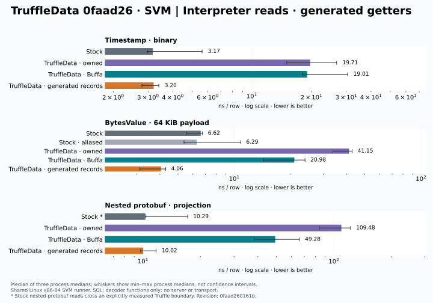
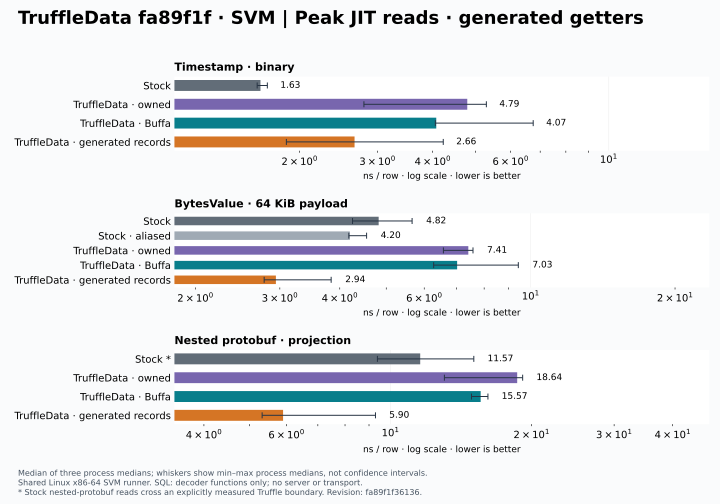
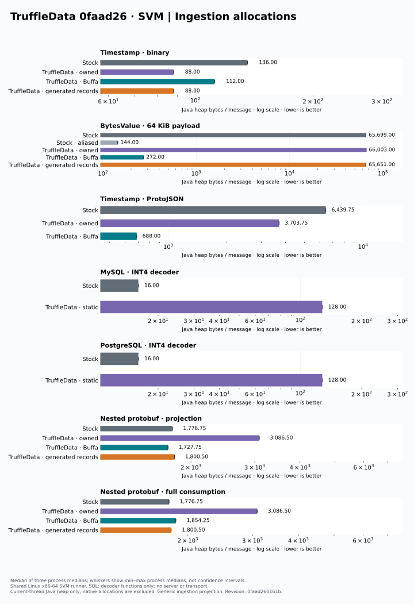
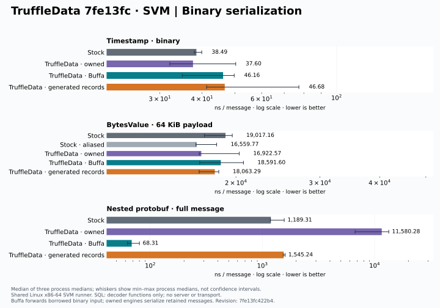

The [chart manifest](images/independent-latest/comparison-manifest.json) identifies the
repeat data, executable and implementation revision. Released 0.4.0 graphics and earlier
development evidence remain above. General and typed simdjson decoding is the next
integration; the Myna value readers and C++ headers are prepared as separate Bazel targets.

## Stable-host profiling cycle: Myna 0.8.0

The [`7260cb8` unclemax cycle](../benchmarks/results/svm-unclemax-7260cb8/comparison.md)
runs all 120 cells with three fresh timing processes and three separate allocation
processes per cell, pinned to CPUs 2–9 on a Threadripper PRO 9965WX. No profiling
process ran concurrently with timing. Native memory is excluded from Java counters.

| Operation | Stock | TruffleData | Stock / TruffleData Java bytes |
| --- | ---: | ---: | ---: |
| Scalar generated ingestion | 47.61 ns | 17.68 ns | 136 / 88 |
| Scalar generated peak reads | 0.80 ns | 0.82 ns | 1 / 1 |
| Scalar generated parse/project peak | 33.79 ns | 7.77 ns | 137 / 1 |
| Nested generic owned ingestion | 633.47 ns | 3126.00 ns | 1776.75 / 2976 |
| Nested Buffa ingestion | 633.47 ns | 2464.89 ns | 1776.75 / 1727.75 |
| Nested generated ingestion | 633.47 ns | 688.59 ns | 1776.75 / 1800.50 |
| Nested generated full consumption | 693.03 ns | 729.18 ns | 1776.75 / 1800.50 |
| Nested generated serialization | 428.96 ns | 469.84 ns | 436.50 / 192.50 |

Scalar peak traces show one loop and zero calls for stock, generated-owned,
compact-owned generated access, and Buffa generated access. Stock and generated-owned
last-tier code both occupy 655 bytes (58 versus 57 IR nodes). This is evidence of
comparable compilation for this fixture, not proof that all paths match stock.

Post-warmup JFR plus symbolized hardware profiles identify the next costs:

- Generic owned nested ingestion: static storage filling, field validation, and
  repeated payload accounting. `StaticLayout.read` accounts for 8.52% of hardware
  samples, `State.finish` 6.75%, and `PayloadBudget.accept` 4.68%.
- Buffa nested ingestion: Java `State.consume` (13.19%) and `State.finish` (10.91%)
  together exceed native `Decoder.binary` (9.47%). Optimizing only the native parser
  would leave substantial Java materialization work.
- Generated nested ingestion: varint decoding (11.36%) and UTF-8 validation/counting
  (8.81%) are prominent, followed by generated consume/finish methods.
- SQL fixtures: per-row benchmark dispatch (`startsWith`) and uncached library lookup
  are visible costs alongside storage construction; do not attribute the entire
  measured difference to driver decoding or static storage.

Hardware percentages are sampled self time for the whole diagnostic process;
JFR records only the post-warmup interval. Raw counts, fork ranges, binary hashes,
compiler traces, and the exact profiling patch are retained in the result directory.

To record a single steady-state cell with the separate profiling executable:

```sh
bazel build //benchmarks/comparison:svm_profile --remote_download_outputs=toplevel
# Run the Linux amd64 executable on the measurement host:
./truffledata-comparison-profile -Xmx1g proto-mixed owned ingest time owned.jfr
python3 tools/bench/json_profile_summary.py recordings dev.elide.truffledata.comparison.Comparison
```

The optional fifth argument selects post-warmup recording; the original repeated
profiling mode remains available without it. Record a `binary.sha256` file in the
recordings directory for the summary tool. Never use instrumented timings as scores.

## Buffa standard-contract proof reuse

Revision `8b05d0b` removes the second field/element validation walk when the
completed native-decoded value has exactly its standard protobuf contract. Native
kind/index checks, required fields, depth/work budgets, duplicate handling, map
semantics, and scoped ownership remain enforced. Strict mode rechecks completed
values, including deferred UTF-8 strings, with the general field validator.

The [paired unclemax cycle](../benchmarks/results/buffa-contracts-8b05d0b/paired.md)
randomizes five fresh forks per binary/cell/metric, with stock and generated-owned
controls. Baseline and candidate processes never overlap.

| Buffa operation | Baseline | Candidate | Java bytes, unchanged |
| --- | ---: | ---: | ---: |
| Nested ingestion | 2496.95 ns | 2115.37 ns | 1727.75 |
| Nested ingestion with generated getters | 2303.79 ns | 1979.80 ns | 1727.75 |
| Nested full consumption | 3098.03 ns | 2941.41 ns | 1854.25 |

The first two cases improve roughly 15% and 14%, with disjoint fork-median ranges.
The stock control also improves about 2%, and generated-owned control ranges overlap;
these controls bound how confidently to attribute timing changes to this patch.
The unchanged compact-scalar control has overlapping ranges and a slightly higher
candidate median. This is not a universal speedup or parity claim: nested Buffa
ingestion still trails the stock control (651.23 ns).

Strict JVM/native/fallback acceptance, the shipping-mode comparison smoke, and a new
full non-strict JVM acceptance target all pass. CI runs both strict and non-strict
variants in its Codecov cycle. That cycle covers 299/317 BuffaPlan lines and 22/22
methods; the shortcut and strict audit lines are exercised. Future richer-contract
fallback branches remain unexercised because current ProtoPlan schemas derive their
contracts directly from FieldPlan.

## Reusing validated defaults during materialization

Revision `8f2e21e` caches immutable protobuf defaults once per compiled schema.
A message copies those references into its existing values array, and absent
standard fields skip unnecessary finalization work. Required fields still fail
when absent; empty repeated values still bind to each message owner. Strict mode
retains the full finalization/audit route. The per-schema template adds no
per-message allocation and copies no payload.

Two randomized five-fork cycles use identical baseline/candidate binaries:
[first](../benchmarks/results/buffa-defaults-8f2e21e/paired.md) and
[repeat](../benchmarks/results/buffa-defaults-8f2e21e/repeat/paired.md).

| Buffa operation | First baseline → candidate | Repeat baseline → candidate |
| --- | ---: | ---: |
| Nested ingestion | 2194.74 → 2100.54 ns | 2105.18 → 2008.56 ns |
| Nested ingestion with generated getters | 2089.92 → 1969.48 ns | 2037.68 → 1888.43 ns |
| Nested full consumption | 2786.65 → 2859.04 ns | 2868.67 → 2718.39 ns |

Projected ingestion improves roughly 4–7% across the two runs. Generic projection
ranges overlap; generated-getter projection ranges are narrowly disjoint.
Full-consumption and unchanged control ranges overlap, with medians moving in
different directions; this does not establish a full-consumption speedup. Java
allocations remain 1727.75 bytes for projected ingestion and 1854.25 for full
consumption. Native memory and the per-schema template are outside these
per-message Java measurements.

Strict/non-strict JVM acceptance, SVM acceptance, native comparison smoke, and
Gazelle drift pass. The coverage cycle and access-method gate also pass, with
303/321 BuffaPlan lines and 22/22 methods covered; the new absent-field route is
exercised by the non-strict corpus. Existing tests include custom proto2 defaults,
explicit default presence, wide presence masks, oneof switching, and independently
closed empty repeated arrays.

## Reusing the native Buffa index

Revision `10592bd` retains the temporary typed index in each native backend instead
of allocating, growing, and freeing it for every message. Materialized messages
remain independent of that scratch allocation. Native tests check allocation-free
warmed reuse, failure/recovery ownership, and smaller-budget enforcement; JVM and
SVM acceptance exercise live messages across reuse and typed/generic transitions.
This retains native memory until an incompatible budget, native parse failure,
generic decode, or backend close releases it. Java allocation is unchanged.

Two randomized five-fork cycles on unclemax compare identical binaries against
the preceding default-template optimization:
[first](../benchmarks/results/buffa-reuse-10592bd/paired.md) and
[repeat](../benchmarks/results/buffa-reuse-10592bd/repeat/paired.md).

| Buffa operation | First baseline → candidate | Repeat baseline → candidate |
| --- | ---: | ---: |
| Nested ingestion | 2013.80 → 1980.76 ns | 2001.10 → 1983.04 ns |
| Nested ingestion with generated getters | 1971.90 → 1865.86 ns | 1982.52 → 1795.42 ns |
| Nested full consumption | 2877.50 → 2723.85 ns | 2729.04 → 2744.00 ns |

Generated-getter ingestion improves 5–9% by median, but fork ranges overlap.
Generic ingestion moves only 1–2%; full consumption is inconsistent across runs.
Unchanged stock and generated-owned controls also have overlapping ranges.
The robust result is eliminating warmed native index allocations, not a universal
throughput gain. Projected Java allocation stays at 1727.75 bytes/op, excluding
native memory. Stock ingestion remains around 665–668 ns in the candidate runs,
so mixed-message Buffa ingestion still has a substantial performance gap.

A refreshed symbolized SVM profile of this revision records four cells sequentially
on unclemax. In the generic nested ingestion case, hardware self samples attribute
16.31% to `State.consume`, 10.87% to `State.finish`, 11.35% to native binary parsing,
and 6.23% to SVM's general object-clone routine. Direct buffer reads and checked
long-to-int conversion account for another 9.48%. This supports targeting Java
materialization next. Post-warmup JFR also places consume/finish first; its Java
stacks cannot separate native work from the calling Java frame. Full consumption
additionally spends substantial time in uncached library dispatch. These profiles
are diagnostic, not timing scores; allocation sample counts are not byte totals.
See the [hardware summary](../benchmarks/results/buffa-reuse-10592bd/perf-summary.json),
[JFR summary](../benchmarks/results/buffa-reuse-10592bd/profile-summary.json), and
[artifact hashes](../benchmarks/results/buffa-reuse-10592bd/profile-artifacts.sha256).

## Copying defaults with a known array type

Revision `cb2e5e6` replaces the default-template `clone()` with an explicitly
`Object[]`-typed `Arrays.copyOf`, targeting the general clone routine observed in
the preceding profile. Ownership, array contents, and per-message allocation are
unchanged. Strict/non-strict JVM acceptance, SVM acceptance, comparison smoke,
and Gazelle drift pass.

Three randomized five-fork cycles retain identical baseline/candidate binaries:
[first](../benchmarks/results/buffa-arraycopy-cb2e5e6/paired.md),
[second](../benchmarks/results/buffa-arraycopy-cb2e5e6/repeat/paired.md), and
[third](../benchmarks/results/buffa-arraycopy-cb2e5e6/repeat2/paired.md).
Generated-getter ingestion medians move 1797.53 → 1708.20 ns,
1862.47 → 1788.47 ns, and 1879.16 → 1726.29 ns, respectively (4–8%).
Fork ranges overlap. Generic projection is flat in the first cycle and improves
in the others; full consumption improves in the first two and regresses in the
third. Unchanged controls also move: the compact-scalar candidate is slower in
the second cycle and faster in the third, while stock favors the candidate in
all three. Consequently these results do not isolate a general causal speedup.
The targeted change is retained, with no new allocation or correctness tradeoff;
the raw controls and inconsistent cases remain part of the evidence.

## Linking nested profiles at schema compilation

Revision `a39d493` resolves nested materialization profiles once per compiled plan.
It replaces a name-map lookup for every nested message with a direct profile link,
including root and registered Any types. Linking happens after all profiles exist
so recursive schemas retain their cycles. Each message still uses its original
ProtoPlan, budgets, and ownership; only profile lookup changes. Links add
per-schema references but no per-message allocation.

Two randomized five-fork cycles compare identical binaries:
[first](../benchmarks/results/buffa-links-a39d493/paired.md) and
[repeat](../benchmarks/results/buffa-links-a39d493/repeat/paired.md).

| Buffa operation | First baseline → candidate | Repeat baseline → candidate |
| --- | ---: | ---: |
| Nested ingestion | 1994.44 → 1813.03 ns | 1891.64 → 1822.11 ns |
| Nested ingestion with generated getters | 1801.96 → 1662.64 ns | 1781.07 → 1706.15 ns |
| Nested full consumption | 2655.30 → 2554.12 ns | 2506.32 → 2462.35 ns |

Projected ingestion improves roughly 4–9% by median. Its first-cycle ranges are
disjoint, while repeat ranges overlap. Full-consumption ranges overlap in both.
Unchanged controls vary in both directions, so these are bounded experimental
results, not a universal speedup. Java allocation remains 1727.75 bytes/op for
projection and 1854.25 for full consumption. Strict/non-strict JVM acceptance,
SVM acceptance, comparison smoke, and Gazelle drift pass, including the existing
recursive, merged-message, map-default, and registered Any cases.

The coverage cycle and access-method gate pass: 315/333 BuffaPlan lines and
22/22 methods, with 65/65 TypedRow lines and 17/17 methods covered.

## Compact native index extents (unreleased ABI 7)

Revision `b325755` reduces native index entries from 32 to 24 bytes by storing
payload lengths and subtree ends as 32-bit values. Input regions and native
allocation budgets already cap these at Java-indexable sizes; scalar values
remain 64-bit. Rust checks length conversion, Java checks lengths/subtree bounds,
and generated ABI fingerprints reject old layouts. Native boundary/budget tests,
strict/non-strict JVM acceptance, SVM/fallback acceptance, and static published
consumer tests pass. The change is not part of release 0.5.0.

Two randomized five-fork cycles retain identical binaries:
[first](../benchmarks/results/buffa-compact-index-b325755/paired.md) and
[repeat](../benchmarks/results/buffa-compact-index-b325755/repeat/paired.md).
The first run's mixed ingestion medians regress roughly 2–6%; the repeat is flat
within 1%. Fork ranges overlap, and unchanged controls vary. There is **no
demonstrated throughput improvement**. Projected Java allocation remains
1727.75 bytes/op and full consumption 1854.25. The verified benefit is 25% less
storage per native index entry (and per retained capacity slot), not a reduction
in total message memory or Java allocations. The change is retained for that
bounded native-memory saving; the raw results include the unfavorable first run.

### Rejected separate binary materialization loop

A follow-up experiment split binary traversal from text/JSON-specific handling,
while sharing scalar conversion and finalization. JVM strict/non-strict, SVM,
comparison smoke, and drift checks passed. Two paired five-fork cycles showed
only 1–2% lower generic-ingestion medians with overlapping ranges; generated
projection and full consumption changed direction between cycles. The unchanged
stock control also shifted substantially in the second cycle. Java allocation
was unchanged. This did not justify duplicated traversal code, so the experiment
was reverted. The [first run](../benchmarks/results/buffa-binary-loop-rejected/paired.md),
[repeat](../benchmarks/results/buffa-binary-loop-rejected/repeat/paired.md), and
[exact patch](../benchmarks/results/buffa-binary-loop-rejected/experiment.patch)
remain available for reproduction.

### Rejected dense field lookup; tighter CPU affinity

A native lookup experiment checked the likely ordinal for consecutive field
numbers before falling back to the existing scan. Rust dense/sparse/reordered
lookup and no-allocation tests plus both JVM acceptance modes passed. The
[CPUs 2–9 run](../benchmarks/results/buffa-dense-lookup-rejected/paired.md) was
mostly flat with overlapping ranges. A second paired cycle on **CPU 2 only**
substantially narrowed the ranges:
[single-CPU results](../benchmarks/results/buffa-dense-lookup-rejected/single-cpu/paired.md).
Projected ingestion was flat, full consumption was 1.4% faster by median, and
the scalar case slightly slower. Scalar Buffa also uses this lookup, so only
stock and generated-owned are unchanged controls for this experiment. Java
allocation was unchanged. The shortcut was reverted rather than retained as
a generally useful throughput improvement.

Use CPU 2 for subsequent serial ingestion experiments on unclemax, and record
the affinity with each result. Compare variants within the same affinity
condition; do not combine the absolute timings from these two conditions.
The prior experiments remain recorded with their original CPU 2–9 affinity,
ranges, and uncertainty. The saved patch and binary hashes allow reproduction.

### Sparse Buffa finalization

The next experiment uses the existing presence bits to visit only present fields,
plus absent required/repeated/nonstandard-contract fields, when a schema has at
most 64 fields. Strict mode and larger schemas retain full traversal. A per-schema
mask adds one `long`; per-message Java allocation is unchanged. Absent standard
defaults were already validated at plan construction. Empty repeated values still
receive the current message owner, and required fields still fail when absent.

Two five-fork paired runs on unclemax pinned to CPU 2 measured mixed ingestion
at **1723 → 1677 ns** and **1714 → 1666 ns**, with disjoint fork-median ranges.
Generated-getter ingestion measured **1599 → 1568 ns** and **1607 → 1557 ns**;
the first run's ranges overlap. Full consumption measured **2440 → 2387 ns** and
**2421 → 2373 ns**, with disjoint ranges. Java allocation remains **1727.75 B**
for projected ingestion and **1854.25 B** for full consumption; native storage is
excluded. Stock remains around **642–655 ns**: the performance gap is still large.

Unchanged controls retain some variation. Scalar ingestion bypasses this finish
loop, so its observed improvement is not evidence of a direct benefit from the
mask. These are small measured improvements, not universal speedup guarantees.
Raw rows, exact binary hashes, candidate patch and provenance are retained in
[`buffa-sparse-finish`](../benchmarks/results/buffa-sparse-finish/paired.md) and
[its repeat](../benchmarks/results/buffa-sparse-finish/repeat/paired.md).

Validation includes strict/non-strict JVM acceptance, strict SVM acceptance, and a
new non-strict SVM image that executes the optimized path. Required empty binary
input rejection is explicit; existing tests cover presence widths 0/1/63/64/65/129,
oneofs, empty repeated ownership, nested merges and map defaults. CI and the full
release publisher now run both strict and non-strict native acceptance.

A refreshed diagnostic profile after sparse finalization confirms that Java index
consumption remains the main hot path. For mixed generic ingestion, hardware
samples attribute 19.02% self time to `State.consume`, 12.50% to native binary
parsing, 10.51% to `State.finish`, and 8.67% combined to direct-buffer integer/long
reads. All four recordings report zero lost perf samples. JFR allocation samples
remain dominated by object arrays, staging states, typed rows and deferred strings;
these counts are not allocated bytes. Full consumption also spends substantial
Java-visible time in uncached library lookup/dispatch. The next experiment combines
adjacent index integer fields into checked 64-bit loads, preserving validation.
[Profile summary](../benchmarks/results/buffa-sparse-finish/profile-summary.json),
[hardware summary](../benchmarks/results/buffa-sparse-finish/perf-summary.json), and
artifact hashes are retained alongside the paired data. Diagnostic image timings
are not comparison scores.

### Paired native index loads

ABI 7's adjacent `number/kind` and `length/end` fields can each share one checked
64-bit load. Native byte-order extraction preserves signed bounds checks and all
kind/subtree validation. This reduces the main consumption loop from five buffer
loads to three without an ABI change, unchecked access, copying, or new allocation.

Two five-fork CPU-2 runs with matching release/build inputs measured mixed generic
Buffa ingestion at **1671 → 1597 ns** and **1670 → 1581 ns**; generated-getter
consumption at **1545 → 1467 ns** and **1551 → 1471 ns**; and full consumption at
**2379 → 2301 ns** and **2375 → 2305 ns**. All these fork-median ranges are disjoint.
Java allocation is unchanged. Strict/non-strict JVM and SVM acceptance pass.

These are observed binary-to-binary improvements, not an isolated universal 5%
causal speedup: unchanged stock controls also improve roughly 2–3%, and generated
owned controls move more. Code layout and build variation remain material. Stock
in the candidate image is **621–623 ns**, versus **1467–1471 ns** for Buffa with
generated getters: about **2.36× slower**, so parity is still unfinished. The
three-load implementation is retained, with this attribution limitation explicit.

[Matched run](../benchmarks/results/buffa-paired-load/paired.md),
[repeat](../benchmarks/results/buffa-paired-load/repeat/paired.md), exact hashes,
patch, acceptance links and initial runs using older release metadata are retained
in the result directory. No profile-image timing is used in these comparisons.

## Protobuf against stock after ABI 9 (2026-11-06)

The shared consumer (`benchmarks/comparison/CONSUMER.md`) is now the authoritative protobuf
comparison. It covers stock, generated-owned, opt-in native views and the default eager decode.
Its stages include decode-only, resident, heap, detach, first, interpreter and peak, and a ~52 KB
large-message throughput cohort. It runs on SVM and JVM remote workers, with paired
baselines on the same worker. Final state (`a58a36d`, SVM, × stock latency):

| Operation | native view | default decode | generated owned |
|---|---:|---:|---:|
| Projected ingestion | 1.02× | 1.99× | 1.04× |
| Full ingestion + consumption | 1.44× | 2.03× | 1.04× |
| Decode only, ~150 B | 0.89× | 1.86× | 1.06× |
| Interpreter reads (full) | 6.37× | 5.44× | 4.77× |
| Peak reads (full) | ~1.6–2.1× | 1.15× | 0.42× |

Native views are now at or ahead of stock for decode-only and projected ingestion. Full
consumption, the default decode, interpreter reads and detachment remain slower than stock.
Small messages decode at about 190–220 MB/s and large ones at about 180–280 MB/s on these
workers. No engine reaches GB/s on this schema. Stock under HotSpot reaches 530 and 390 MB/s.
The historical generated-getter harness (`measure`, and `measure_views` for opt-in views) was
rerun unpaired. In it, views are at 1.09× projected, 1.92× full, 3.33× interpreter and 1.87× peak.
See the [cycle README](../benchmarks/results/protobuf-f26678a/README.md) for every cell, Java
and native bytes, JVM tables and caveats.
